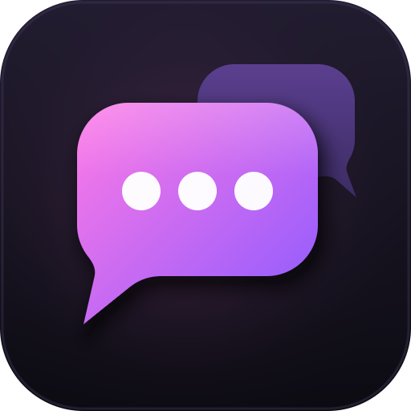

# DMme

**Stop losing whispers in busy chat.**

DMme gives each of your private conversations its own window. Chat with friends, guildmates or the player selling the thing you've been farming for, without scrolling past trade chat to find what they said.

Works on **Retail** (12.1.5, plus the 12.1.7 PTR) and **Forever**.

## What it does

**A window for every conversation**
Each whisper opens in a clean, compact window. You can have them all in one window with a tab per person, or keep them as separate windows you can move and resize anywhere.

**Battle.net friends included**
Whispers from Battle.net friends show up too, along with the character they're currently playing. Your lines and theirs are easy to tell apart, and Battle.net messages can have their own sound.

**Start a chat from anywhere**
Right-click a name in chat, a portrait or a raid frame and pick **Open Whisper Window**. Or open the **Friends** tab in DMme's list and click anyone who's online. On Forever, players' full two-part names are used.

**Pick a look**
Three themes: **Dark**, a clean modern style; **Forever**, which matches the game's own chat and dialog frames; and **Midnight**, a darker take on the game style. You can also change the text size.

**Quick replies**
Save the replies you send all the time ("brb", "inv please", "thanks!") and use them from a button on each window. Click one to put it in the text box, or Shift-click to send it right away. You can reorder them and turn off the Shift safety in settings.

**Emoji and links**
Type `:)`, `<3` or `:fire:` and they show as emoji, or pick one from the emoji button in the text box. Links in messages are clickable and open a box where you can copy them.

**No pop-ups mid-fight**
Whispers that arrive during combat wait until the fight is over before their window opens. Nothing is lost: the minimap button still lights up.

**Spam filter**
Gold sellers and boosting ads are caught before they open a window. Friends, guildmates, your group and anyone you're already talking to are never filtered. You can view what was blocked and edit the word list.

**Mute someone**
Need a break from someone? Right-click their name and choose **Mute whispers** for 1 hour, 24 hours, a week, a month or forever. Their whispers won't open a window, play a sound or show in your main chat, and they can't tell. The mute ends by itself, or you can unmute them early from the same menu or from **Settings → Chat → Show muted**.

**See who you're talking to**
Names, messages and tabs use each player's class color. Click **Who** to fill in the window header with their level, race, class and guild. Hover over the name for the full details.

**Never miss a message**
The minimap button glows and shows how many conversations are waiting for you. Click it for a list of everyone you've talked to this session, with their last message. Middle-click or Shift-click it to mark everything as read. The list stays through `/reload` and clears when you log out.

**A button you can put anywhere**
Does your minimap addon collect every button into a bag? Turn on the floating DMme button, drag it where you like and resize it with Ctrl + mouse wheel. It's off by default.

**Keep your conversations (optional)**
Turn on history to save your whispers between sessions. You can browse, search and copy them later in the History window, and choose how long to keep them: a day, a week, a month, a year or forever. It's off by default.

**Make it yours**
Settings are split into General, Look, Chat and History tabs. Choose tabs or separate windows (and whether the X closes one tab or all of them), the whisper sound, window size and colors. Pick which quick buttons each window shows: Party Invite, Who, History, Quick replies, plus an optional Guild Invite shortcut. You can also hide whispers from your main chat. On Retail, DMme is also in the addon menu by the minimap.

## Commands

| Command | What it does |
|---|---|
| `/dm` | Open settings |
| `/dm open <name>` | Start a conversation with someone |
| `/dm list` | Show this session's conversations |
| `/dm read` | Mark all whispers as read |
| `/dm friends` | Show online friends, click one to chat |
| `/dm history` | Browse saved conversations |
| `/dm mute <name> [1h\|24h\|week\|month\|forever]` | Mute someone's whispers |
| `/dm unmute <name>` | Unmute someone |
| `/dm tabs` | Switch between tabs and separate windows |
| `/dm theme dark\|forever\|midnight` | Switch the look |
| `/dm button [size\|reset]` | Show, resize or reset the floating button |
| `/dm help` | Show every command |

`/dmme` works too.

Emoji images are [Twemoji](https://github.com/twitter/twemoji), CC-BY 4.0.
